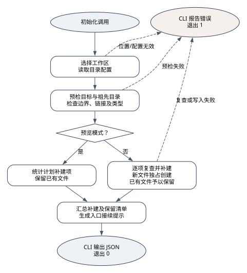
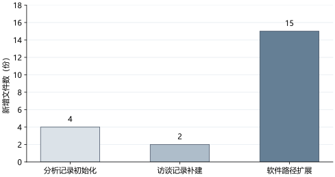

# 图表示例：初始化流程与真实新增文件数

本例用本仓库的工具解释两件事：初始化器如何处理预览、补建和错误；一次实际接续调用新增多少文件。它演示技术图和数据图的来源、图源、导出及检查方式，不是一篇真实毕业论文。

## 技术流程图



[可编辑 DOT 图源](initializer-flow.dot) 对应 [初始化器](../../scripts/init_workspace.py) 的 `initialize`、`validate_before_write` 和 `main`。图从参数解析后的初始化调用开始，概括工作区/配置选择、全量预检、预览或实际补建、已有文件保留、接续提示及错误返回。命令行参数语法错误退出 2 不在这张图的范围内。

虚线表示位置/配置、预检或实际复查/写入失败时的错误路径。目录和新文件创建前仍会分别检查，图为处理概览，没有展开每个文件的循环。创建成功不代表论文定位、大纲、研究或测试已经完成；路径检查和写入也不具备原子防竞态或自动回滚保证。

本次使用已存在的 `@viz-js/viz` 3.25.0（内含 Graphviz 14.1.3）渲染 SVG，再用已存在的本地 SVG 渲染能力生成临时 PNG 进行目视检查。中文标签曾出现超出节点的问题，已通过分行和明确节点最小宽度修正。已检查中文显示、箭头和分支标签、重叠与裁切；尚未插入学校模板检查实际文档页面。

如果当前环境已有 Graphviz，可在仓库根目录复跑：

```text
dot -Tsvg examples/figures/initializer-flow.dot -o "<临时输出目录>/initializer-flow.svg"
```

也可用当前已经具备并已核实接口的 DOT 渲染器。不同版本和字体可能产生不同布局，重新导出后仍需检查；本例不要求为渲染图安装 Node 或额外服务。

## 数据图与原始口径



数据来自 [实际运行观察](../initialization-study/observation.json) 的 `analysis_created_files`、`intake_created_files` 和 `upgrade_created_files`。本例只比较同一次 `analysis → intake → software` 调用序列中每次新增的文件数量，单位为“份”，纵轴从零开始。不同配置的目录职责不同，这些数字不是研究质量、完成百分比、执行时间或性能指标。

本次实际计数依次为 **4、2、15**。观察记录对应的初始化器源码 SHA-256 为 `7f614f2df34b33ad8eefc6d88de0c54be1acc62ff4b109622561349297ccc7ba`；CSV 已逐项对照实际观察，未手工补写计数。导出使用 Windows、Python 3.14.6、Matplotlib 3.11.0 与 Microsoft YaHei，已检查 PNG 预览中的中文、单位、零起点和三个数值标签。同一环境复跑得到相同 SVG 和 CSV 字节，不据此承诺其他渲染版本生成相同布局或字节。

[source_data.csv](source_data.csv) 保留本次观察中用于绘图的类别、显示名、键名与原始计数；[render_chart.py](render_chart.py) 从指定观察 JSON 读取和验证整数，然后生成 CSV 及 [SVG 导出](counts.svg)。SVG 中中文以路径保存以减少字体替换，但数据和脚本仍是后续编辑依据。原始观察含初始化器源码指纹与实际运行环境；重新运行观察或修改初始化器后应一并更新数据与图，不能手改柱高以配合正文。

当前已有 Matplotlib 和支持中文的字体时，在仓库根目录显式给出输出路径：

```text
python examples/figures/render_chart.py --observation examples/initialization-study/observation.json --svg "<临时输出目录>/counts.svg" --csv "<临时输出目录>/source_data.csv" --png "<临时输出目录>/counts-preview.png"
```

没有命令行输出参数时不会写入本仓库。脚本不安装依赖；没有 Matplotlib 或中文字体时，仍可读取 CSV，使用当前可用的绘图库或文档原生图表生成同口径图表，明确尚未渲染或检查的部分。

## 检查与使用范围

- 内容核实：技术图回查代码，数据图逐项对应观察键与 CSV 数值；不能以渲染成功替代内容核实。
- 导出检查：检查中文、单位、零起点、数值标注、节点边界、线条和裁切，保留可编辑图源及数据。
- 正式论文：题名、编号、字号、插入尺寸和图文引用应按实际学校规范及章节安排确定。本例未做 Word 页面或学校格式验收，不提供统一的字号或 DPI 标准。

临时 PNG 仅用于本次目视检查，不随示例发行；SVG、DOT、数据和生成脚本随技能保留。
